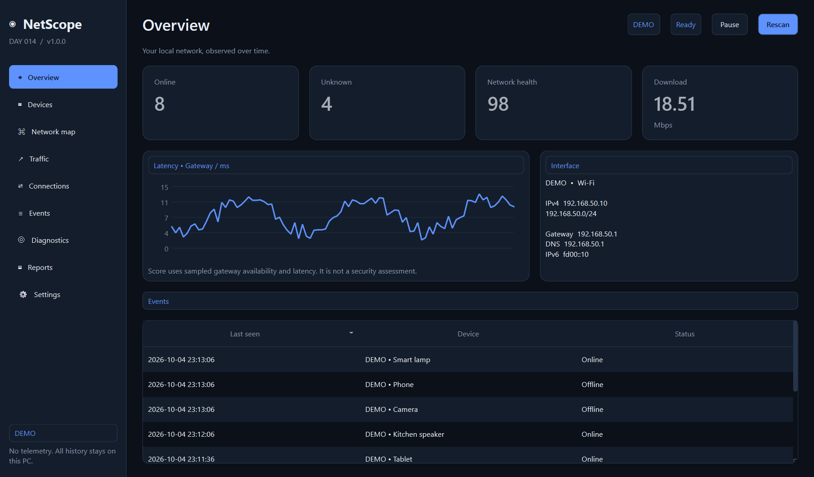
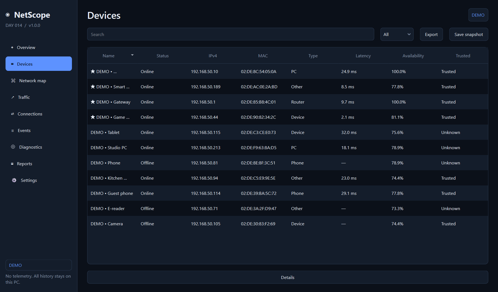
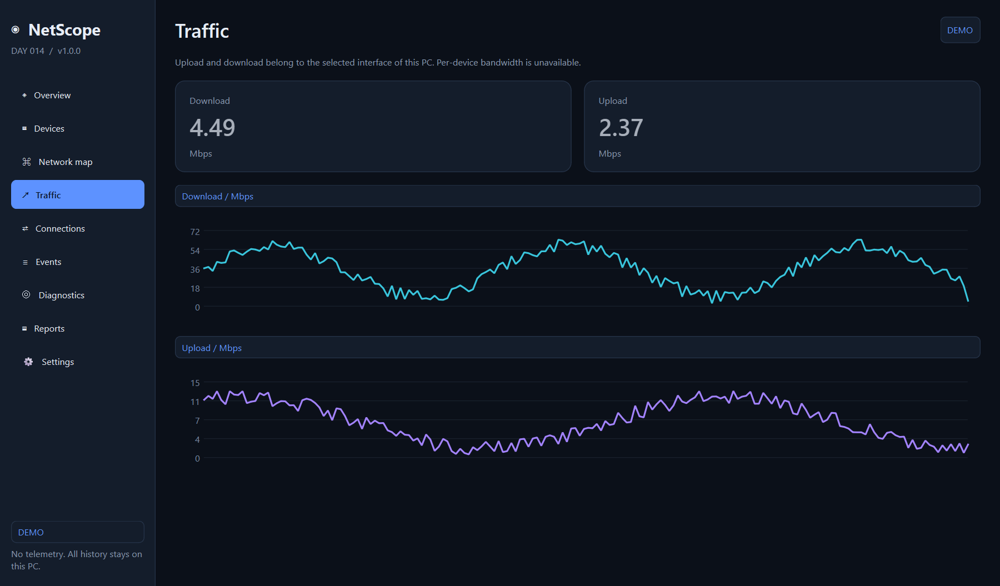
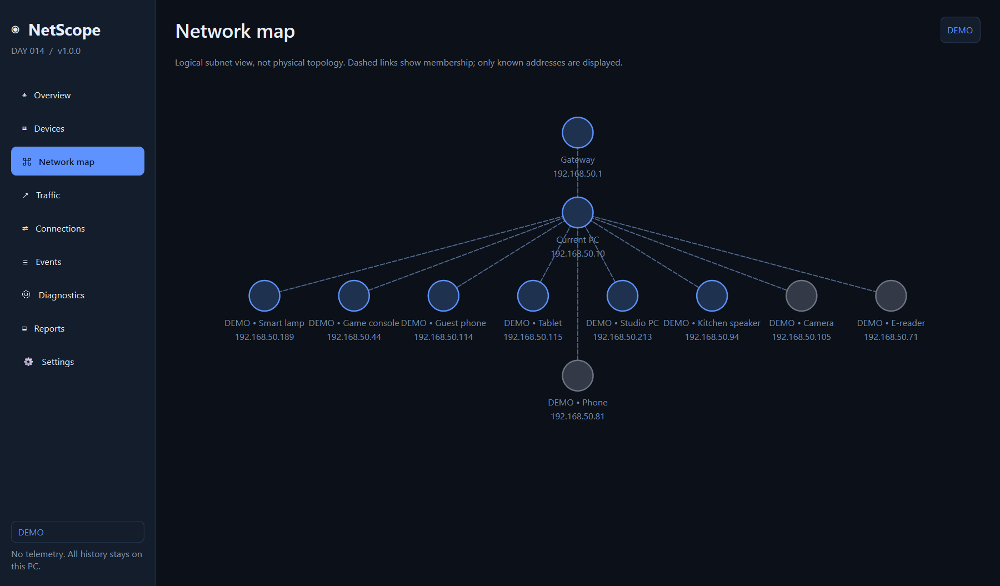
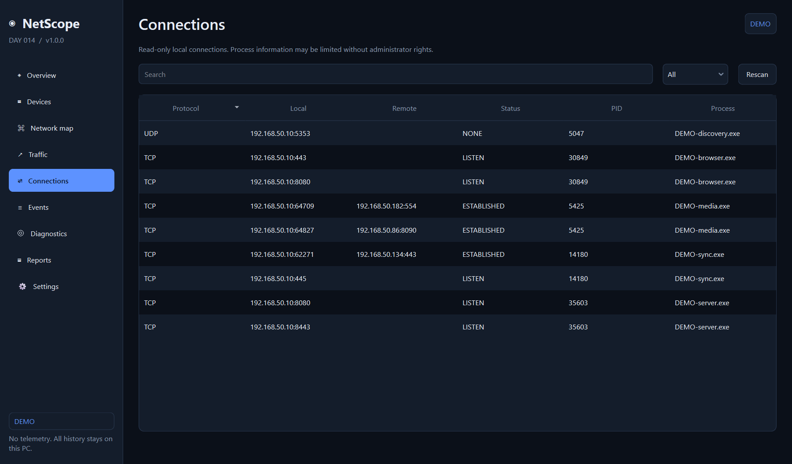
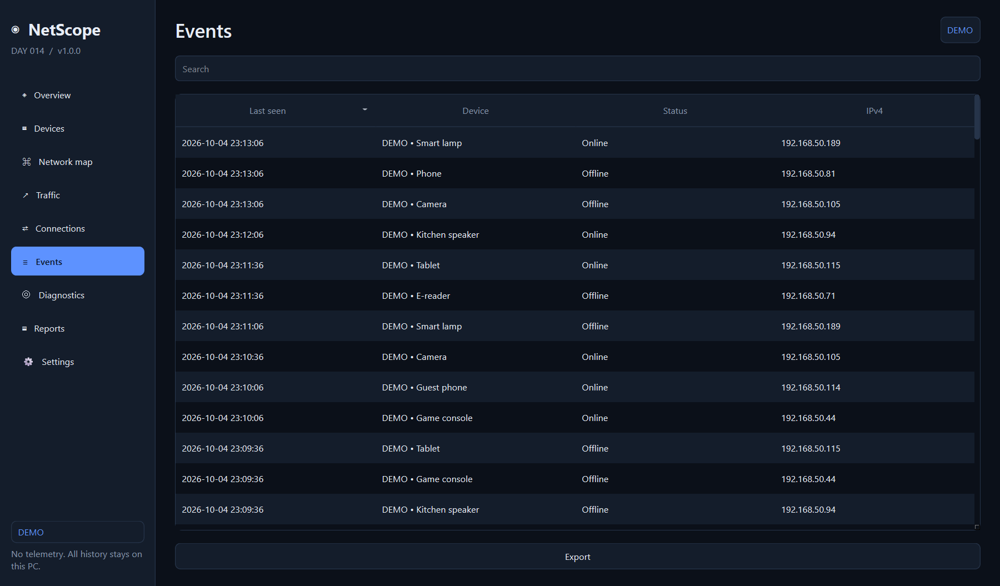
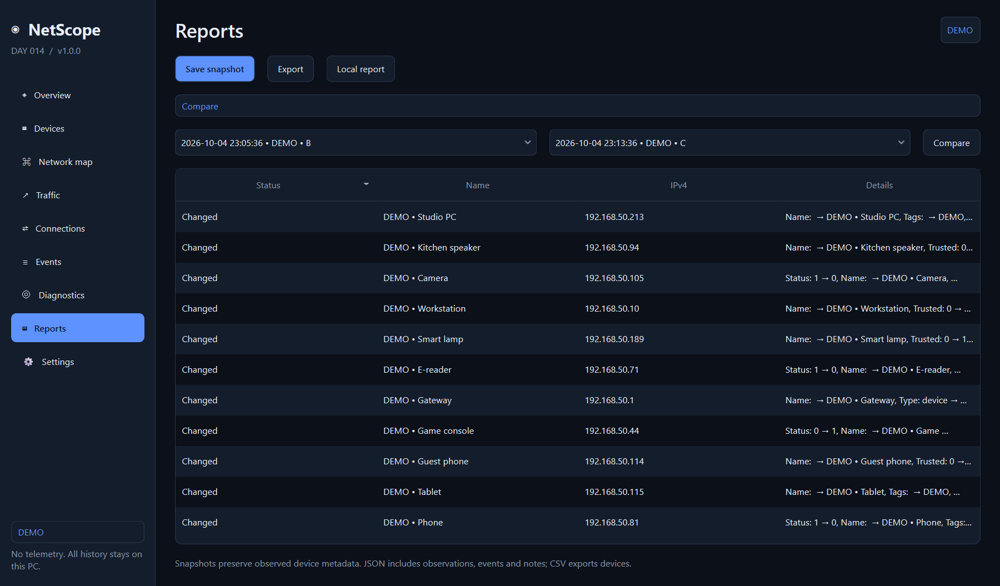

# NetScope — Day 014

**A Windows desktop home-network monitor. Local data, no account, no telemetry.**

Python 3.12+, PySide6 / Qt 6, SQLite, psutil. Develop in VS Code; Visual Studio, WPF, WinUI and Windows Forms are not required.


[](https://github.com/mnerst1/NetScope/releases/tag/v1.0.0)
[](https://www.python.org/)
[](LICENSE)

**[Download v1.0.0 for Windows](https://github.com/mnerst1/NetScope/releases/tag/v1.0.0)** · [Русский](#русский) · [Қазақша](#қазақша)

| Download | Recommended use |
| --- | --- |
| [Windows installer](https://github.com/mnerst1/NetScope/releases/download/v1.0.0/NetScope-Setup-v1.0.0.exe) | Per-user installation, Start Menu, optional Desktop shortcut, uninstall |
| [Portable ZIP — recommended](https://github.com/mnerst1/NetScope/releases/download/v1.0.0/NetScope-v1.0.0-Windows-x64.zip) | Extract and keep the entire NetScope folder |
| [Standalone EXE](https://github.com/mnerst1/NetScope/releases/download/v1.0.0/NetScope-v1.0.0-Windows-x64.exe) | Onefile convenience build; slower first startup |
| [Onefile ZIP with notices](https://github.com/mnerst1/NetScope/releases/download/v1.0.0/NetScope-v1.0.0-Windows-x64-OneFile.zip) | Standalone EXE plus docs and third-party license notices |
| [Source ZIP](https://github.com/mnerst1/NetScope/releases/download/v1.0.0/NetScope-v1.0.0-source.zip) | VS Code development and rebuilding |

### Screenshots — generated DEMO data

All screenshots below use isolated synthetic records. They do not show a real home network.



| Devices | Traffic |
| --- | --- |
|  |  |

| Network map | Connections |
| --- | --- |
|  |  |

| Events | Reports and snapshots |
| --- | --- |
|  |  |

[Device details](docs/screenshots/device-details.png) · [Diagnostics](docs/screenshots/diagnostics.png) · [Settings and Demo records button](docs/screenshots/settings.png)

## English

### Start

```powershell
py -3.12 -m venv .venv
.\.venv\Scripts\python.exe -m pip install -r requirements.txt
.\.venv\Scripts\python.exe main.py
# Clearly labeled, isolated synthetic dataset:
.\.venv\Scripts\python.exe main.py --demo
```

Open this folder in VS Code, install Microsoft's Python extension, select `.venv\Scripts\python.exe`, then use F5. Launch profiles are provided for live and DEMO modes. Python 3.12 x64 is the tested runtime; newer Python versions depend on compatible binary wheels.

### What you can use

- Overview: device counts, unknown devices, gateway health score, local interface information and recent events.
- Devices: online/offline, IPv4, MAC when available, local hostname when available, vendor from bundled data, first/last seen, custom name/type/tags, trusted/favorite flags, notes and sampled availability. Double-click a device for its details.
- Latency: stored one-packet ICMP samples, gaps for unsuccessful probes, packet-loss percentage, timeline. Availability is successful observations / recorded observations, **not measured continuous uptime**. A firewall or sleeping device can look offline.
- Network Map: a logical subnet membership view of gateway → this PC → observed peers. Dashed links are **not physical links**. Up to 16 peer nodes are drawn; the full inventory is in Devices. No switches, Wi-Fi associations or routes are invented.
- Traffic: selected-interface counters on **this PC** in Mbps; history is recorded every two seconds. No per-device bandwidth claim.
- Connections: read-only TCP listening/established and UDP endpoints, local/remote address, PID and process name. Search and status/protocol filtering. No connection termination.
- Events: discovery and online/offline transitions, search, persistent local history.
- Diagnostics: local interface, gateway ICMP and a local DNS `localhost` query only if the configured resolver is private. No public internet-speed or external-connectivity probe. A skipped DNS check is not a failed check.
- Reports: devices CSV/JSON, history JSON or observation CSV, offline HTML report, snapshots and comparison of added/removed/changed devices.
- Settings: interface, 15–3600-second interval, 1–365-day retention, notification toggles, system tray and optional HKCU Windows autostart.
- Ctrl+K command/device search, F5 rescan, table sorting and context menus.

### Discovery and honest limitations

Discovery is **off until explicitly enabled in onboarding or Settings**. Use it only on your own or authorized network. Select the active physical adapter rather than a virtual/VPN adapter. The first adapter with a default IPv4 gateway and the lowest reported route metric is preferred. Windows IP Helper API reads gateway/DNS information without WMI or administrator privileges; PowerShell is a best-effort fallback. IPv6 is shown, but discovery is IPv4 only.

Scanning supports RFC1918 and link-local IPv4 subnets **/24 or smaller (at most 254 hosts)**. Larger subnets are declined with a translated explanation; there is no arbitrary CIDR or public-range scan field. ICMP: one request per address, 12 concurrent processes, 650 ms reply timeout, 2.5 s hard subprocess timeout. Interface source address and interface-scoped ARP table are used on Windows. There are no overlapping scans. Pause stops future scans; an already running scan finishes.

Only a successful ICMP reply proves online presence. ARP-cache entries add MAC metadata but do not prove presence by themselves. ICMP-blocked devices can be missed. Hostnames come from this PC, the local hosts file, or a bounded NetBIOS node-status query (`nbtstat -A`) for newly responding local hosts; no reverse DNS queries to external resolvers. Some devices offer no usable hostname. A MAC identifies a device when available; IP fallback cannot perfectly distinguish devices without MACs. DHCP reuse with different known MACs creates a separate device and preserves previous history.

Devices keeps the full persistent inventory, including previously selected networks. Online/offline is the last recorded probe result, not a live guarantee between scans. Overview counts and the logical map use the currently selected subnet. Hover the scan status to see the most recent completed scan time.

Vendor data: 40,033 exact 24-bit MAC prefix assignments from the [official Wireshark manufacturer database](https://www.wireshark.org/download/automated/data/manuf). The source header and retrieval date are in `netscope/assets/OUI_SOURCE.txt`. No runtime downloads or lookups. Local/randomized and multicast MACs deliberately have no vendor. Prefixes are manufacturer hints, not definitive device-model identities. 28/36-bit assignments are not included.

Port checking requires the **Check common ports** button in a device dialog. The allowlist is 21, 22, 53, 80, 139, 443, 445, 554, 631, 3389, 8080, 8443. One socket at a time, 350 ms timeout, 150 ms delay, at most one operation per 15 seconds. Targets must be in the selected private subnet. There is no UDP port sweep, banner collection, exploit scan or service identification. “Closed or filtered” does not distinguish rejection from a timeout.

The app works without administrator rights. Restricted process details, ARP information, OS services, firewall policies and host sandboxes can limit results. Missing information is shown as `—` rather than invented. ICMP errors and timeouts are unsuccessful reachability observations; they do not prove the device is powered off. No packet-capture driver or payload capture exists.

The health score requires a sampled gateway: `clamp(100 × successful samples / samples − min(30, average RTT / 5), 0, 100)` for up to 20 recent observations. It is a reachability indicator, not a security grade or internet-performance test.

### Demo records button

Settings → **Demo records** generates a new randomized, isolated dataset for every tab: 10–18 devices with notes/tags/trust states, 90 scan observations per device, latency/availability/events, 180 traffic samples, synthetic connections/PIDs, diagnostics and three comparable snapshots. It pauses live monitoring and opens the labeled DEMO view; **Settings → Real data** returns to your existing live database and prior monitoring state. Repeat Demo records to regenerate synthetic records. This does not erase or modify live history. Language and appearance are preserved; ordinary network discovery is not used. `main.py --demo-records` opens the same preview directly.

### Localization

23 included locales: English, Русский, Қазақша, Español, Français, Deutsch, Português (Brasil), Italiano, Türkçe, Українська, Polski, Nederlands, العربية, فارسی, हिन्दी, বাংলা, 简体中文, 繁體中文, 日本語, 한국어, Bahasa Indonesia, Tiếng Việt, ไทย.

**122/122 canonical keys in every included locale**, verified by tests. Missing, extra or empty translations fail validation at startup and in tests; individual strings never fall back to English. Arabic/Persian use Qt RTL layout. Language and appearance changes rebuild the pages immediately, preserving database settings and the selected page. Unsaved text in an open device dialog should be saved before changing language.

Key completeness is an automated guarantee. These translations have not undergone independent native-speaker linguistic review. Protocol names, units, user device names, operating-system output, exported machine field names and native OS file dialogs are not app translation keys. Fluent and OLED are style names. The included English DEMO device names are synthetic data.

### Themes and layout

Light / Dark / System; Fluent, Glass, Graphite, Minimal, Compact, OLED. Seven accent presets plus a color picker. Glass uses stable translucent-looking colors and borders, not native backdrop blur. Minimum size 1280×720 in Qt logical pixels; scrollable content prevents clipping. Qt handles HiDPI scaling. At 200% a physical 1280×720 display cannot fit a 1280×720 logical window; use a larger display or lower scaling.

### Architecture and storage

```text
netscope/
  models/          typed interfaces and probe observations
  repositories/    SQLite schema version 1, transactions, metrics, snapshots, retention
  services/        monitoring, demo seed, reports, autostart
  network/         subnet validation, OS adapters, ping/ARP, local names, vendor data
  workers/         QRunnable / QThreadPool with queued result/error signals
  ui/              nine pages, device dialog, widgets, charts and theme tokens
  i18n/locales/    canonical JSON catalogs
  utils/           resource and data paths
  assets/          original SVG/PNG/ICO and offline vendor data
```

Network work, interface enumeration, local connections, traffic persistence and exports run outside the UI thread. SQLite connections are short-lived and per operation with WAL, foreign keys, a busy timeout and atomic settings transactions. `PRAGMA user_version` guards schema compatibility. Current schema is the initial migration; newer unknown versions are refused instead of overwritten.

Default local data: `%LOCALAPPDATA%\NetScope\live\netscope.db` and `demo\netscope.db`. No source-directory DB. Three rotating 1 MB log backups per mode. `--data-dir PATH` still creates distinct `live`/`demo` child folders. Snapshots retain at most 100 records; time series and events use the retention setting, cleaned on startup and after scans. Inventory, notes and user settings are retained. SQLite reuses freed pages; retention does not immediately shrink the file. Keep monitoring active for periodic cleanup. Multiple simultaneous app instances are not supported.

### Test and build

```powershell
.\.venv\Scripts\python.exe -m compileall -q netscope tests main.py
.\.venv\Scripts\python.exe -m pytest -q
.\.venv\Scripts\python.exe main.py --smoke-test --data-dir .\build\smoke
.\build.ps1
.\package_release.ps1
```

Default: `dist\NetScope\NetScope.exe` plus `_internal` dependencies. Keep the **entire folder**. The spec relies on [PyInstaller's PySide6 hooks](https://pyinstaller.org/en/stable/hooks-config.html) and explicitly includes icons, catalogs and the vendor dataset. A Windows build must be produced on Windows. Qt wheels include Qt; no Visual Studio installation is needed. Additional experimental standalone build: `build.ps1 -OneFile`. Both build scripts run tests and a startup smoke test; onefile remains a convenience option with slower extraction.

Optional installer: open `installer.iss` in Inno Setup 6 after the onedir build and compile it. It installs for the current user, with Start Menu and optional Desktop shortcut, and unregisters autostart on uninstall. The database is intentionally preserved when uninstalling. See `BUILD_EXE_RU.md` and `TEST_CHECKLIST.md` for verification boundaries. Repository and release: https://github.com/mnerst1/NetScope.

## Қазақша

NetScope — Windows үшін жергілікті желіні бақылайтын бағдарлама. Тіркелгі, API кілті, бұлт және телеметрия қажет емес. Деректер осы компьютердегі SQLite базасында сақталады. DEMO деректері бөлек сақталады және анық белгіленеді.

VS Code ішінде осы қалтаны ашыңыз. Python 3.12 x64 орнатып, жоғарыдағы Start командаларымен `.venv` жасаңыз, тәуелділіктерді орнатыңыз және `main.py` іске қосыңыз. VS Code интерпретаторы ретінде `.venv\Scripts\python.exe` таңдаңыз. DEMO үшін `main.py --demo` қолданыңыз.

Алғаш іске қосқанда желілік интерфейсті, сканерлеу аралығын және хабарландыруларды таңдаңыз. Құрылғыларды анықтау тек өз желіңізде не рұқсат етілген желіде келісім бергеннен кейін іске қосылады. `/24` немесе одан кіші жеке IPv4 ішкі желілері қолданылады. Құрылғыны екі рет басып атауын, тегтерін, сенім күйін және жазбасын өзгертуге болады.

Қазақ тіліне ауысу: Settings → Language → Қазақша. Барлық 122 аударма кілті автоматты тексеріледі. Бұл тексеру тілдік сараптаманың орнына жүрмейді. Қолжетімділік тіркелген ICMP өлшемдеріне негізделеді; ұйқы режимі мен брандмауэр нәтижеге әсер етуі мүмкін. Трафик тек осы компьютердің интерфейсіне қатысты, ал карта физикалық топологияны көрсетпейді.

`.\build.ps1` EXE жинайды, `.\package_release.ps1` тарату архивін жасайды. `dist\NetScope` қалтасын барлық файлдарымен бірге сақтаңыз. Visual Studio қажет емес.

## Русский

NetScope — центр наблюдения за домашней/локальной сетью для Windows. Работает локально без API, облака, аккаунтов и телеметрии. Исходники готовы для VS Code. Подробный запуск: [INSTALL_RU.md](INSTALL_RU.md), сборка: [BUILD_EXE_RU.md](BUILD_EXE_RU.md).

В настройках добавлена кнопка **Демо-записи**: заполняет все вкладки случайными синтетическими данными. Повторное нажатие создаёт новый набор. В DEMO нажмите **Реальные данные** в настройках, чтобы вернуться к своей истории сети. Реальные записи не перезаписываются.

На первом запуске выберите физический интерфейс, интервал и уведомления, затем явно разрешите обнаружение в своей сети. Двойной щелчок по устройству открывает карточку: имя, тип, доверие, избранное, метки, заметки, история и график. Ctrl+K открывает поиск команд и устройств. Пауза прекращает будущие сканирования, текущее завершается. Закрытие по умолчанию сворачивает приложение в трей; для выхода используйте меню трея.

Поддерживаются частные IPv4-подсети `/24` и меньше. ICMP может блокироваться брандмауэром — «не в сети» означает неуспешную проверку, а не доказанное выключение. Доступность — доля успешных сохранённых проверок, не непрерывный uptime. Трафик измеряется только для интерфейса этого ПК. Карта показывает логическую принадлежность подсети, а не реальные кабели и коммутаторы. Производитель определяется из локального справочника, для случайных MAC не указывается.

Включены 23 языка, в каждом автоматическим тестом подтверждены все 122 ключей. Независимая вычитка носителями языка ещё не проведена. Light/Dark/System, шесть стилей и пользовательский акцент доступны в настройках; Glass реализован устойчивым оформлением без системного blur.

DEMO полностью отделён от настоящих наблюдений. Репозиторий и релиз: https://github.com/mnerst1/NetScope. Windows onedir EXE собран и проверен запуском в среде разработки; полноценную работу на вашей сети и чистом ПК проверьте по `TEST_CHECKLIST.md`.
